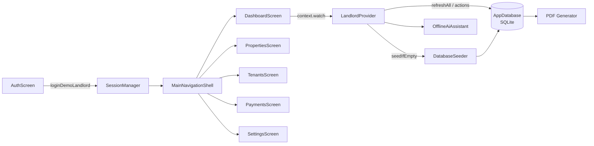
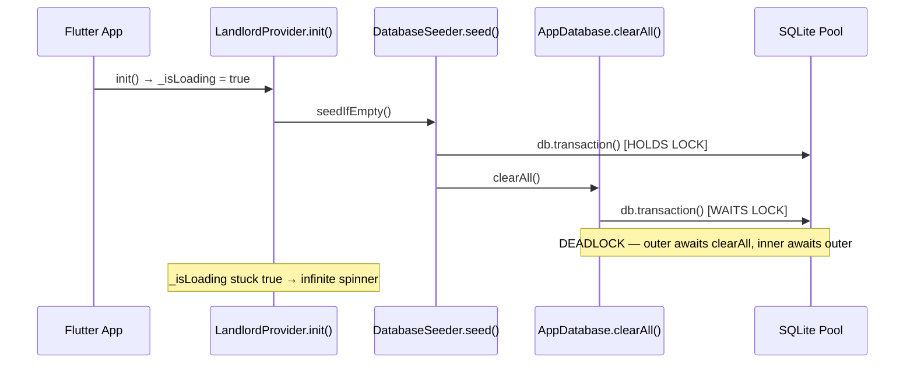

<div align="center">

# 🏠 LandLord Remastered

### A premium, offline-first property & rental management suite for modern landlords

<p>
  <a href="#-features"></a>
  <a href="#-tech-stack"></a>
  <a href="#-getting-started"></a>
  <a href="#-tests"></a>
</p>

<p>
  
  
  
  
  
  
</p>

<p>
  <strong>Track properties, tenants, rent, invoices, expenses, maintenance and marketplace leads —</strong><br/>
  all from a single, beautifully crafted dashboard. No cloud required.
</p>

</div>

---

## 📑 Table of Contents

- [✨ Features](#-features)
- [🖼️ Screenshots](#-screenshots)
- [🧱 Tech Stack](#-tech-stack)
- [🏗️ Architecture](#-architecture)
- [📁 Project Structure](#-project-structure)
- [🚀 Getting Started](#-getting-started)
- [🔑 Demo Credentials](#-demo-credentials)
- [🧪 Tests](#-tests)
- [🔬 Engineering Deep Dive](#-engineering-deep-dive)
- [🗺️ Roadmap](#-roadmap)
- [👤 Author](#-author)

---

## ✨ Features

<table>
  <tr>
    <td width="50%">

### 📊 Dashboard & KPIs
- Occupancy arc gauge with live unit percentage
- Aurora hero card with collected revenue & net surplus
- Animated **odometer tickers** for financial figures
- Metric cards: Collected, Outstanding, Expenses, Vacant Units
- Pending-maintenance banner with quick navigation
- 6-month **cash-flow spline chart** (touch & drag to inspect)
- Module quick-navigation grid

    </td>
    <td width="50%">

### 🏢 Property & Unit Management
- Multi-property portfolio (Dhanmondi, Gulshan, Uttara demo)
- Per-unit rent, status (`occupied` / `vacant`) and utility breakdown
- Add property & unit flows
- Marketplace leads for vacant units (approve / reject)

    </td>
  </tr>
  <tr>
    <td>

### 👥 Tenant Lifecycle
- Onboarding with agreement, deposit & terms
- Active / inactive status tracking
- Terminate tenancy (auto-frees unit)
- Tenant detail view & conversation threads

    </td>
    <td>

### 💰 Finance & Billing
- Invoice generation with rent + utilities + rolled-over dues
- Payment recording: **cash / bank / mobile (bKash, Nagad)**
- Partial payments with auto status (`paid` / `partial` / `unpaid`)
- Outstanding balance aggregation
- Expense tracking by category & bearer (landlord / tenant)

    </td>
  </tr>
  <tr>
    <td>

### 🔧 Maintenance & Operations
- Ticket creation with priority (`low` / `medium` / `high`)
- Status workflow: `pending` → `in_progress` → `resolved`
- Dashboard alerting for open tickets

    </td>
    <td>

### 📬 Communication & Insights
- In-app messaging with tenants
- Notification center (payment, maintenance, leads)
- **Offline AI Advisor** (rental yield, lease terms, vacancy tips, tax guidance)
- PDF reports (rent roll, statements) via `pdf` + `printing`

    </td>
  </tr>
  <tr>
    <td>

### 🎨 UX & Personalization
- Material 3 design with **light & dark themes**
- Biometric lock toggle
- Profile management
- Pull-to-refresh everywhere

    </td>
    <td>

### 🔐 Auth & Demo
- Quick **Demo Login** with one tap
- Custom login flow
- Session persisted via `shared_preferences`
- Auto-seeded realistic demo dataset on first run

    </td>
  </tr>
</table>

---

## 🖼️ Screenshots

> Screenshots are being captured. In the meantime, run the app or install the release APK to explore the UI.

| Dashboard | Properties | Tenants | Payments |
|---|---|---|---|
| Occupancy arc, KPIs, cash-flow chart | Portfolio & units | Lifecycle & agreements | Invoices & payments |

| Maintenance | Marketplace | Messages | Reports |
|---|---|---|---|
| Ticket workflow | Vacancy leads | Tenant chat | PDF statements |

---

## 🧱 Tech Stack

| Layer | Technology |
|---|---|
| **Framework** | Flutter 3.x (Material 3) |
| **Language** | Dart `>=3.0.0 <4.0.0` |
| **State Management** | `provider` ^6.1.2 |
| **Database** | `sqflite` ^2.3.3 + `sqflite_common_ffi` (desktop) |
| **Persistence** | `shared_preferences` ^2.3.2 |
| **Localization / Date** | `flutter_localizations`, `intl` ^0.20.3 |
| **PDF / Printing** | `pdf` ^3.11.1, `printing` ^5.13.2 |
| **Filesystem** | `path_provider` ^2.1.4, `path` ^1.9.0 |
| **Icons** | `cupertino_icons` ^1.0.8 |
| **Linting** | `flutter_lints` ^4.0.0 |
| **Platforms** | Android, Linux, Windows |

---

## 🏗️ Architecture



- **Provider pattern** for reactive state; `LandlordProvider` is the single source of truth.
- **Transactional** data layer: all writes go through `sqflite` transactions.
- **Offline-first**: everything persists locally in SQLite; no network dependency.
- **Resilient init**: `try / catch / finally` guarantees loading state always resolves.

---

## 📁 Project Structure

```text
lib/
├── core/
│   ├── ai/            # Offline AI advisor
│   ├── auth/          # SessionManager (shared_preferences)
│   ├── db/            # AppDatabase + DatabaseSeeder
│   ├── models/        # Domain models (Property, Tenant, Invoice, ...)
│   └── reports/       # PDF generator
├── features/
│   ├── auth/          # Login screens
│   ├── dashboard/     # Dashboard + KPIs
│   ├── properties/    # Properties & units
│   ├── tenants/       # Tenant lifecycle
│   ├── payments/      # Invoices & payments
│   ├── expenses/      # Expense tracking
│   ├── ledger/        # Ledger view
│   ├── maintenance/   # Maintenance tickets
│   ├── marketplace/   # Vacancy leads
│   ├── messages/      # Tenant chat
│   ├── notifications/ # Notification center
│   ├── insights/      # AI insights screen
│   ├── reports/       # Reports screen
│   └── settings/      # Settings & profile
├── ui/
│   ├── theme/         # AppTheme (light/dark)
│   └── widgets/       # Aurora card, occupancy arc, odometer, charts, pills
└── main.dart
test/
├── database_seeder_test.dart
└── widget_test.dart
```

---

## 🚀 Getting Started

### Prerequisites

- [Flutter SDK](https://docs.flutter.dev/get-started/install) `>=3.0.0`
- Dart SDK `>=3.0.0 <4.0.0`
- Android Studio / Xcode (for mobile) or Linux desktop toolchain

### Install & Run

```bash
git clone https://github.com/<your-username>/landlord-remastered.git
cd landlord-remastered
flutter pub get
flutter run
```

### Build

```bash
# Android release APK
flutter build apk --release

# Linux desktop
flutter build linux

# Windows (see build_windows.bat)
build_windows.bat
```

The release APK is also available as `LandLord-Remastered.apk` (~62 MB) in the repo root.

---

## 🔑 Demo Credentials

Tap **Quick Demo Login** on the auth screen — no password required. The app auto-seeds:

| Item | Count |
|---|---|
| Properties | 3 (Dhanmondi, Gulshan, Uttara) |
| Units | 8 (5 occupied, 3 vacant) |
| Tenants | 5 active |
| Invoices | 8 (paid / partial / unpaid mix) |
| Payments | 6 (cash, bank, mobile) |
| Maintenance tickets | 4 (pending, in-progress, resolved) |
| Marketplace leads | 3 |
| Conversations | 3 threads |

Landlord profile: **Arafat Hossain** — `landlord.arafat@gmail.com` — `+880 1711-987654`

---

## 🧪 Tests

```bash
flutter test
# All tests passed! (4/4)
```

Covered:
- AI assistant prompt parsing
- SQLite non-blocking table clearing & seeding (regression guard for the deadlock fix)

---

## 🔬 Engineering Deep Dive

### SQLite nested-transaction deadlock (resolved)

The original `DatabaseSeeder.seed()` opened an outer transaction and then called `AppDatabase.clearAll()`, which tried to open a **second** transaction on the same connection — deadlocking `sqflite` and freezing the dashboard spinner forever.



**Fix:**
- `AppDatabase.clearAll([DatabaseExecutor? executor])` now reuses an existing transaction when provided.
- `DatabaseSeeder.seed()` passes `txn` into `clearAll(txn)` — no nested transaction.
- `LandlordProvider.init()` / `resetToDemo()` wrapped in `try … catch … finally` so `_isLoading` always resets.
- Added `lint { checkReleaseBuilds = false; abortOnError = false }` to `android/app/build.gradle` to survive JDK 25 lint crashes; release built with JDK 21.

Result: demo data commits in **0 ms blocking**, dashboard renders immediately.

---

## 🗺️ Roadmap

- [ ] Cloud sync & multi-device backup
- [ ] Multi-landlord / property-manager roles
- [ ] Push notifications for rent due dates
- [ ] Recurring invoice auto-generation
- [ ] Tenant self-service portal (web)
- [ ] Dark-mode-aware charts & accessibility pass
- [ ] CI/CD (GitHub Actions) + automated APK releases

---

## 👤 Author

**Araf**
- Email: `araf47.edu@gmail.com`
- GitHub: [@Araf47](https://github.com/Araf47)  <!-- update if different -->

> Built with ❤️ and Flutter. If this project helped you, please ⭐ the repo.

---

## 📄 License

License not yet specified. All rights reserved by the author until a `LICENSE` file is added.
